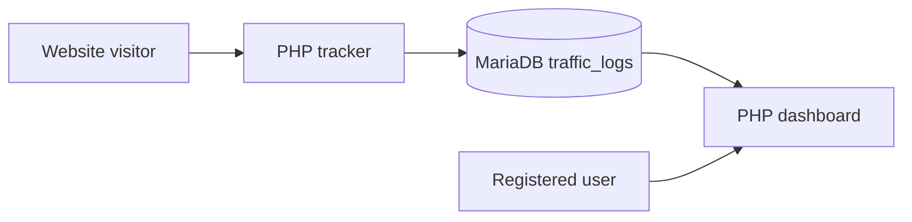

# Web Spark — Website Traffic Analysis Dashboard

  

A PHP-based website traffic monitoring and dashboard project. The repository contains the original PHP pages, styling, images, and a MariaDB/phpMyAdmin database export.

> **Accuracy note:** The current tracker uses a simple user-agent heuristic to label visits as likely automated or non-automated. This is **not** reliable proof of genuine versus fake traffic, and pasting an arbitrary website URL does not grant access to that site's server-side analytics.

## Features

- Account registration, login, profile, and dashboard pages.
- Website management and traffic reporting pages.
- PHP request tracking using visitor IP address and user agent.
- Local MariaDB schema and sample records.

## Technology stack

| Layer | Technology |
| --- | --- |
| Backend | PHP |
| Database | MariaDB / MySQL, MySQLi |
| Frontend | HTML, CSS, JavaScript |
| Local tooling | Apache + PHP + MariaDB (e.g., XAMPP), phpMyAdmin |

## Project structure

```text
Database/web_spark.sql     Database schema and sample data
images/                    Site assets
stylesheet/StyleSheet.css  Styles
index.php                  Landing page
login.php, register.php    Account pages
maindashboard.php          Dashboard
track.php                  Basic traffic logger
mywebiste.php              Website management
```

## Local setup

1. Install Apache, PHP 8.x, and MariaDB/MySQL (for example, XAMPP).
2. Clone into your local web server's document root.
3. Create a local database named `web_spark` and import `Database/web_spark.sql` with phpMyAdmin.
4. Review the PHP files' database connection settings; they currently contain local development values. Configure them for **your** local database.
5. Start Apache and MariaDB, then visit your local project URL.

## Request flow



## Important security limitations

**For educational/local use only; do not deploy publicly without remediation.** The committed database dump includes example user account records and encoded passwords, which should be removed and credentials rotated if ever reused. Current code also contains hard-coded database settings, direct SQL string interpolation in the tracker, and a basic bot heuristic. Before production use, implement parameterized SQL, secure password hashing, session and access controls, consent/privacy notices, and safer configuration management. IP addresses and user agents may be personal data.

The `.env.example` file is a **documentation template**, not an automatically loaded configuration system. PHP code must be updated to load configuration before these values take effect.

## Screenshots

Original UI assets are available in [images/](images/). Add verified screenshots of the running dashboard when available; illustrative assets are not presented as actual application screenshots.

## Licensing

No project-wide open-source license has been selected. All rights remain with their respective copyright holders until a license is explicitly added.
