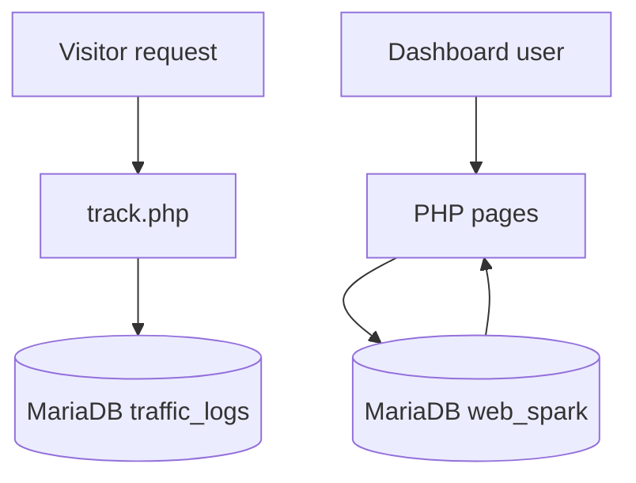

# Web Spark architecture

The application is a PHP multi-page site with styles in `stylesheet/`, image assets in `images/`, and a database export in `Database/web_spark.sql`. The tracker captures request metadata and applies a basic user-agent check; it does not independently measure all traffic to arbitrary external websites.

## Deployment boundary

The included configuration is oriented toward local development. The existing `.env.example` is a reference only: the PHP source does not automatically load it. A secure production deployment requires additional code changes and testing.
